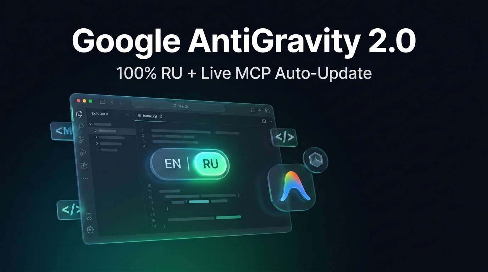

# 🚀 Google AntiGravity 2.0 — Russian Localization & System Enhancement Suite (`antigravity-features-v2`)



[](version.json)
[](LICENSE)
[](https://github.com/WiseYaroslav28/antigravity-features-v2)
[](https://github.com/WiseYaroslav28/antigravity-features-v2)
[](index.js)
[](https://www.youtube.com/shorts/sucYFc3UqpM)
[](https://habr.com/ru/articles/1104106/)
[](https://vc.ru/id6168328/3229744-rusifikator-google-antigravity-2-0-avtoobnovleniem-cherez-mcp)
[](https://web.tribute.tg/d/SGR)

> **🇷🇺 Полный русификатор Google AntiGravity 2.0 (100% перевод интерфейса, настроек, плагинов, навыков и меню `/`)**, авто-патчер `app.asar`, сохранение позиции окна на 2-м мониторе, исправление клика по иконке в системном трее и **MCP-сервер с автоматическим обновлением через GitHub**.  
> **🇬🇧 Complete Russian Localization & Quality-of-Life Enhancement Suite for Google AntiGravity 2.0 IDE** — featuring non-invasive CDP live injection, native `app.asar` auto-patching, multi-monitor window state persistence, system tray fixes, and a self-updating MCP server.

🌐 **Навигация / Links:** [**🇷🇺 Русский**](#-русская-документация-ru) | [**🇬🇧 English**](#-english-documentation-en) | [**▶️ Видео (YouTube)**](https://www.youtube.com/shorts/sucYFc3UqpM) | [**📖 Хабр**](https://habr.com/ru/articles/1104106/) | [**📰 VC.ru**](https://vc.ru/id6168328/3229744-rusifikator-google-antigravity-2-0-avtoobnovleniem-cherez-mcp) | [**💬 Заказать доработку**](https://github.com/WiseYaroslav28/antigravity-features-v2/issues/new/choose) | [**💖 Поддержать / Donate**](#-поддержать-проект--support--donate)

> [!IMPORTANT]
> **Обновились до Google AntiGravity `2.33.0` и пропал перевод / плашка `EN | RU`?**  
> Переустанавливать ничего не нужно! В `2.33.0` Google убрала дефолтный ключ `remote-debugging-port`, но ваш фоновый MCP-сервер продолжает работать: просто **подождите 15–20 секунд** (он сам скачает фикс `v2.1.45` с GitHub и перепатчит `app.asar`), затем **один раз полностью перезапустите AntiGravity** (включая выход из системного трея) — русский интерфейс и плашка вернутся автоматически.

---

## 🇷🇺 Русская документация (RU)

### ✨ Основные возможности

1. **100% Русская локализация интерфейса (Русификатор Google AntiGravity 2.0)**:
   * Полный перевод всех разделов настроек (*Аккаунт, Внешний вид, Модели, Персонализация, Браузер, Уведомления и звук, Приложение, Разрешения*).
   * Перевод меню быстрых команд (`/`), карточек и всплывающих описаний всех встроенных навыков (`Skills`) и плагинов (*Chrome DevTools, Modern Web Guidance, Accessibility, LCP Optimization* и др.).
   * Перевод статусов выполнения задач агента (`Выполняется`, `Создано`, `Отменено`, `Размышляет`) и системных контекстных меню Electron (*Вырезать, Копировать, Вставить, Выделить всё*).
   * **Переключатель `EN | RU` в шапке окна**: мгновенное переключение между русским и английским языками в реальном времени без перезапуска IDE.

2. **🔄 Автоматическое обновление с GitHub силами MCP (без ручного скачивания)**:
   * Встроенный MCP-сервер ([`index.js`](index.js)) автоматически проверяет наличие новых версий в этом репозитории ([`version.json`](version.json)) по HTTPS — **работает даже если на ПК не установлен Git**.
   * Скачивает обновлённые файлы в фоне и проверяет их синтаксис через компилятор V8 (`node --check`) перед заменой.
   * **Горячее применение (Hot-Reload)**: новые переводы мгновенно применяются к открытым окнам через Chrome DevTools Protocol (CDP) без перезапуска приложения, а в виджете `EN | RU` отображается переход версий (например, `✨ v2.0.0 → v2.1.26`) и список изменений (`changelog`).

3. **🖥️ Запоминание 2-го монитора и развёрнутого состояния окна**:
   * Исправляет сброс окна на основной монитор (`1400x900`) при каждом запуске: сохраняет точные координаты (`x`, `y`, `width`, `height`, `isMaximized`) и открывает AntiGravity именно на том мониторе, где вы его закрыли.

4. **🖱️ Исправление системного трея и ярлыка рабочего стола**:
   * Активирует одиночный и двойной клик левой кнопкой мыши по иконке AntiGravity в системном трее Windows.
   * Исправляет повторный запуск по ярлыку (`second-instance`), когда окно свёрнуто в трей.

---

### ⚡ Мгновенная установка (Windows и macOS)

#### Способ 1. Попросить саму AntiGravity установить русификатор себе (Self-Install Prompt)
Откройте чат в вашей AntiGravity, вставьте этот промпт и нажмите **Enter**:

* **Для Windows:**
  > ```text
  > Установи полный русификатор и MCP-сервер автообновления AntiGravity 2.0 из репозитория https://github.com/WiseYaroslav28/antigravity-features-v2 — выполни в PowerShell команду: irm https://raw.githubusercontent.com/WiseYaroslav28/antigravity-features-v2/main/install.ps1 | iex
  > ```
* **Для macOS (Apple Silicon & Intel):**
  > ```text
  > Установи полный русификатор и MCP-сервер автообновления AntiGravity 2.0 для macOS из репозитория https://github.com/WiseYaroslav28/antigravity-features-v2 — выполни в bash команду: curl -fsSL https://raw.githubusercontent.com/WiseYaroslav28/antigravity-features-v2/main/install.sh | bash
  > ```

#### Способ 2. Одной командой в терминале (работает даже без Git)

* **Windows (PowerShell):**
  ```powershell
  irm https://raw.githubusercontent.com/WiseYaroslav28/antigravity-features-v2/main/install.ps1 | iex
  ```
* **macOS (Terminal — Apple Silicon & Intel, с автоподписью `codesign` для Gatekeeper):**
  ```bash
  curl -fsSL https://raw.githubusercontent.com/WiseYaroslav28/antigravity-features-v2/main/install.sh | bash
  ```

#### Способ 3. Классическая установка через `git clone`

1. Скачайте архив репозитория или склонируйте его:
   ```cmd
   git clone https://github.com/WiseYaroslav28/antigravity-features-v2.git
   ```
2. Запустите установочный скрипт:
   ```cmd
   install_on_new_pc.bat
   ```
   **Что сделает установщик автоматически:**
   * Зарегистрирует MCP-сервер `antigravity-features-v2` в `%USERPROFILE%\.gemini\config\mcp_config.json`.
   * Установит необходимые пакеты (`npm install`).
   * Соберёт и проверит патч `app.asar.patched` с помощью [`auto_patcher.cjs`](auto_patcher.cjs).
   * Создаст резервную копию оригинального файла (`app.asar.bak`) и применит локализацию.

---

### 🔄 Управление автообновлением и чистое удаление (Uninstall)

* **Временное переключение на английский:** нажмите кнопку **`EN`** в верхнем виджете `EN | RU` — оригинальный интерфейс вернётся мгновенно без перезапуска и удаления.
* **Отключение автообновлений с GitHub:** нажмите на иконку **`i`** рядом с `EN | RU` и переключите тумблер **«🔄 Автообновление с GitHub»** в положение `Выкл`. Локальный перевод сохранится, а новые версии с GitHub будут устанавливаться только вручную по кнопке.
* **Полное удаление в 1 клик из интерфейса:** откройте меню иконки **`i`** → нажмите **«🗑️ Удалить русификатор…»** → **«Да, удалить»**. Скрипт автоматически уберёт запись из `mcp_config.json`, вернёт заводской `app.asar` (с переподписью `codesign` на macOS), удалит папку `~/.antigravity-features-v2` и перезапустит чистую AntiGravity.
* **Удаление одной командой в терминале:**
  * **Windows (PowerShell):**
    ```powershell
    irm https://raw.githubusercontent.com/WiseYaroslav28/antigravity-features-v2/main/uninstall.ps1 | iex
    ```
  * **macOS (Terminal / Bash):**
    ```bash
    curl -fsSL https://raw.githubusercontent.com/WiseYaroslav28/antigravity-features-v2/main/uninstall.sh | bash
    ```

---

### 🗂️ Архитектура проекта

| Файл | Назначение |
| :--- | :--- |
| [`version.json`](version.json) | Паспорт релиза: номер версии SemVer (`2.1.26`), дата, описание изменений (`changelog`) и список обновляемых файлов. |
| [`index.js`](index.js) | Фоновый MCP-сервер, движок автообновления с GitHub и локальный HTTP-сервер статуса и hot-reload (`http://127.0.0.1:39228/localization.js`) без зависимости от `remote-debugging-port: 9222`. |
| [`src/`](src/) + [`build.cjs`](build.cjs) | Модульные исходники русификатора (`helpers.js`, `dict-ui.js`, `dict-plugins.js`, `step-engine.js`, `regex-rules.js`, `dom-engine.js`, `topbar-ui.js`, `terminal-boot.js`) и zero-dependency сборщик (`npm run build`). |
| [`localization_injected.js`](localization_injected.js) | Автособираемый бандл словаря переводов, регулярных выражений, движка `MutationObserver` и виджета `EN \| RU` (полная обратная совместимость с автообновлением). |
| [`auto_patcher.cjs`](auto_patcher.cjs) | Автоматический сборщик `app.asar.patched` с проверкой каждого файла компилятором V8 (`vm.Script`). |
| [`exit_patcher.cjs`](exit_patcher.cjs) | Фоновый модуль тихой подмены `app.asar` после штатного закрытия AntiGravity пользователем. |
| [`mac_updater.cjs`](mac_updater.cjs) | Безопасный установщик обновлений AntiGravity на macOS (проверка SHA-512 и официальной подписи Google LLC `EQHXZ8M8AV`, атомарная замена `.app` с откатом и автоперепатчиванием). |
| [`backup_manager.js`](backup_manager.js) | Служба резервного копирования состояния и координат окна каждые 30 секунд. |
| [`install_on_new_pc.bat`](install_on_new_pc.bat) | Автоматический установщик для Windows. |
| [`install.sh`](install.sh) | Однострочный bash-установщик для macOS / Unix с автоматической переподписью `codesign`. |
| [`uninstaller.cjs`](uninstaller.cjs), [`uninstall.ps1`](uninstall.ps1), [`uninstall.sh`](uninstall.sh) | Модуль и скрипты полного удаления русификатора, отката заводского `app.asar` и очистки `mcp_config.json`. |
| [`apply_patch_and_restart.bat`](apply_patch_and_restart.bat) | Скрипт быстрой подмены `app.asar` и перезапуска AntiGravity в 1 клик (Windows). |

---

## 🇬🇧 English Documentation (EN)

### ✨ Key Features

1. **Complete Russian UI Localization (100% Coverage for Google AntiGravity 2.0)**:
   * Translates all Settings tabs (*Account, Appearance, Models, Personalization, Browser, Notifications & Sound, Application, Permissions*), slash commands (`/`), built-in `Skills` and plugin cards, agent step statuses, and native Electron menus.
   * Includes a live top-bar **`EN | RU` language switcher** allowing instant toggling between English and Russian without restarting the IDE.

2. **🔄 Zero-Touch GitHub Auto-Updater via MCP**:
   * The bundled Model Context Protocol (MCP) server ([`index.js`](index.js)) periodically checks [`version.json`](version.json) on GitHub over HTTPS (works even on machines without Git installed).
   * Validates every downloaded `.js`/`.cjs` file using Node's V8 syntax checker (`node --check`) before replacing local files.
   * **Live HTTP Hot-Reload (Zero CDP Required)**: dictionary updates are served locally from `http://127.0.0.1:39228/localization.js` and hot-loaded directly by the UI & `plugin://` subframes with zero downtime and no `--remote-debugging-port=9222` flag required.
   * **Modular Source Architecture**: edit clean modules in [`src/`](src/) (`dict-ui.js`, `dict-plugins.js`, `step-engine.js`, `regex-rules.js`, `dom-engine.js`, `topbar-ui.js`, `terminal-boot.js`) and run `npm run build` ([`build.cjs`](build.cjs)) to assemble the backwards-compatible `localization_injected.js`.

3. **🖥️ Multi-Monitor Window Geometry & Maximized State Persistence**:
   * Fixes the default `1400x900` primary-monitor reset by persisting `x`, `y`, `width`, `height`, and `isMaximized` state across sessions.

4. **🖱️ System Tray Left-Click & Desktop Shortcut Restore Fixes**:
   * Patches `dist/tray.js` and `dist/main.js` inside `app.asar` so left-clicking/double-clicking the tray icon or re-launching the desktop shortcut reliably restores the window from the system tray.

### 🚀 Quick Start (1-Line Install)

**Windows (PowerShell):**
```powershell
irm https://raw.githubusercontent.com/WiseYaroslav28/antigravity-features-v2/main/install.ps1 | iex
```

**macOS (Apple Silicon & Intel):**
```bash
curl -fsSL https://raw.githubusercontent.com/WiseYaroslav28/antigravity-features-v2/main/install.sh | bash
```

### 🗑️ Clean Uninstall (UI or 1-Line Terminal)

You can toggle auto-updates ON/OFF or uninstall cleanly directly from the top-bar **`i`** menu (**`🗑️ Удалить русификатор…`**), or via a single terminal command (restores factory `app.asar`, unregisters MCP from `mcp_config.json`, and removes `~/.antigravity-features-v2`):

* **Windows (PowerShell):** `irm https://raw.githubusercontent.com/WiseYaroslav28/antigravity-features-v2/main/uninstall.ps1 | iex`
* **macOS (Bash):** `curl -fsSL https://raw.githubusercontent.com/WiseYaroslav28/antigravity-features-v2/main/uninstall.sh | bash`

---

## 💖 Поддержать проект / Support & Donate

Если проект оказался вам полезен, вы можете поддержать его развитие из любой точки мира (РФ, СНГ и любые зарубежные страны):  
If you find this project helpful, you can support its continued development:

[](https://web.tribute.tg/d/SGR)
[](https://t.me/tribute/app?startapp=dSGR)

* **💳 Банковские карты (РФ, СНГ и весь мир) в браузере / Bank Cards (Web)**: [https://web.tribute.tg/d/SGR](https://web.tribute.tg/d/SGR)
* **✈️ Донат через Telegram (Карты и Telegram Stars)**: [https://t.me/tribute/app?startapp=dSGR](https://t.me/tribute/app?startapp=dSGR)
* **💎 Криптовалюта / Crypto (Ethereum `ETH` и любые токены `ERC-20`: `USDT`, `USDC` в сети Ethereum)**:
  ```text
  0x729D819802EF2B8Eaab8eE7F0431fE1d288E6688
  ```

---

## 👨‍💻 Автор и публикации / Author & Media

Автор проекта: **Ярослав (Yaroslav Wise — [@WiseYaroslav28](https://github.com/WiseYaroslav28))**
* **▶️ YouTube-канал**: [@Yaroslav_Wise](https://www.youtube.com/@Yaroslav_Wise) • [Видеодемонстрация русификатора (Shorts)](https://www.youtube.com/shorts/sucYFc3UqpM)
* **📖 Блог на Хабре**: [@Wise_Yaroslav](https://habr.com/ru/users/Wise_Yaroslav/) • [Статья: «Как я сделал 100% русификатор Google AntiGravity 2.0 с живым автообновлением через MCP и CDP»](https://habr.com/ru/articles/1104106/)
* **📰 Блог на VC.ru**: [vc.ru/id6168328](https://vc.ru/id6168328) • [Разбор проекта на VC.ru](https://vc.ru/id6168328/3229744-rusifikator-google-antigravity-2-0-avtoobnovleniem-cherez-mcp)
* **💬 Предложить идею или заказать доработку**: [Оставить заявку в GitHub Issues](https://github.com/WiseYaroslav28/antigravity-features-v2/issues/new/choose)

---

## 🤝 Благодарности и участники / Contributors

Спасибо участникам сообщества за вклад в развитие проекта:
* **[@MrRay57](https://github.com/MrRay57)** — кроссплатформенная адаптация под **macOS**, автоматическая переподпись бандла `codesign` и [`install.sh`](install.sh) ([PR #1](https://github.com/WiseYaroslav28/antigravity-features-v2/pull/1)), адаптивный дизайн плашки `EN | RU` ([PR #2](https://github.com/WiseYaroslav28/antigravity-features-v2/pull/2)), безопасное автообновление на macOS через [`mac_updater.cjs`](mac_updater.cjs) с проверкой подписи Google LLC ([PR #3](https://github.com/WiseYaroslav28/antigravity-features-v2/pull/3)).

---

## 📜 Лицензия / License

Этот проект распространяется свободно под открытой лицензией **MIT License**. Вы можете свободно использовать, изучать, модифицировать и распространять код. Подробности в файле [`LICENSE`](LICENSE).

This project is free and open-source software licensed under the **MIT License**. See [`LICENSE`](LICENSE) for full details.

---

### 🔍 Поисковые теги / SEO Keywords
`Google AntiGravity 2.0`, `AntiGravity IDE`, `Русификатор AntiGravity`, `Русский язык в Google AntiGravity`, `Локализация AntiGravity 2.0`, `AntiGravity Russian Translation`, `AntiGravity Localization`, `Model Context Protocol`, `MCP Server`, `Electron asar patcher`, `Chrome DevTools Protocol injection`, `AntiGravity Tray Fix`, `AntiGravity Second Monitor Fix`.
